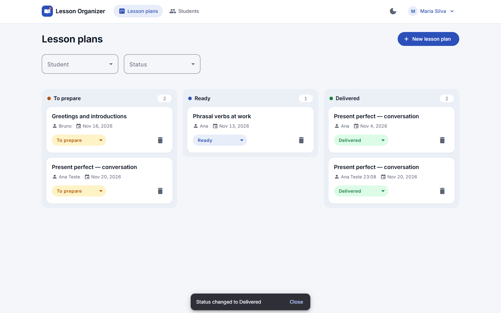
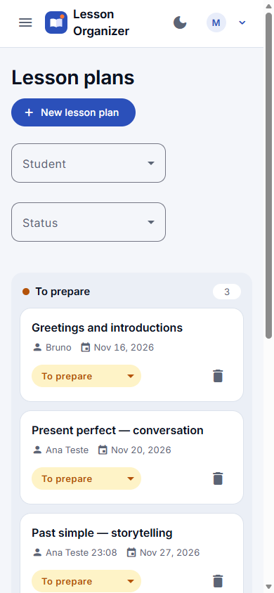
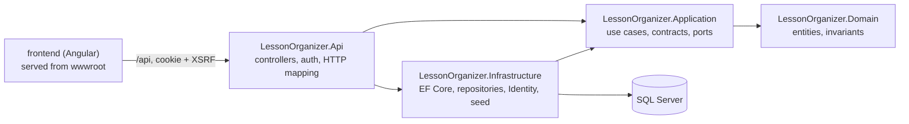

# Lesson Organizer

Web app for independent English teachers to manage students and lesson plans.

## What it is

A small planner for teachers who give private English lessons. A teacher registers their students and keeps a board of lesson plans for them, moving each plan from **To prepare** to **Ready** to **Delivered**. Each teacher sees only their own data.

> As an independent English teacher, I want to register my students and organize their lesson plans so that I can track what needs preparation, what is ready, and which lessons have been delivered.

- Backend: .NET 10 ASP.NET Core Web API, Clean Architecture (Domain, Application, Infrastructure, Api), SQL Server with EF Core, ASP.NET Core Identity with a cookie session.
- Frontend: Angular 22 with Angular Material, served by the API on the same origin.
- Requirements: [docs/requirements.md](docs/requirements.md). Design and API contracts: [docs/plan.md](docs/plan.md).

## Screenshots

| Lesson plan board (desktop) | Phone |
|---|---|
|  |  |

## Prerequisites

- **Demo:** Docker Desktop (or Docker Engine with Compose v2) and about 3 GB of free RAM. Nothing else.
- **Development:** also .NET SDK 10.0.4xx, Node.js 26 and npm (versions in [docs/stack.md](docs/stack.md)).

## Run it

### Demo (one command)

```bash
cp .env.example .env          # then set MSSQL_SA_PASSWORD (8+ chars with upper, lower, digit, symbol; avoid ; ' " $)
docker compose up --build
```

Open **http://localhost:8080** and log in with a demo account below. The first start builds the image (a few minutes), waits for SQL Server, applies the migrations and seeds the demo data.

- Stop: `Ctrl+C`, or `docker compose stop`.
- Start again: `docker compose up` (data and login sessions are kept).
- Reset to a fresh seed: `docker compose down -v` (deletes the database volume, including any development data, since development uses the same `db` service), then `docker compose up`.

### Development

1. `cp .env.example .env`, set the SQL Server password, then `docker compose up -d db`.
2. Store the connection string once with `dotnet user-secrets` (see the Commands table in [CLAUDE.md](CLAUDE.md#commands)).
3. `dotnet run --project src/LessonOrganizer.Api --launch-profile https` — applies migrations and seeds the demo data. API docs (Scalar) at `https://localhost:7141/scalar`.
4. `cd frontend && npm ci && npm start`, then open `http://localhost:4200`. The dev server proxies `/api` to `https://localhost:7141`, so the app and the API share one origin.

In VS Code, steps 3 and 4 are one launch: Run and Debug → **API + Frontend** (F5). It starts the `db` container, builds and runs the API with the `https` profile, starts `ng serve` and opens Chrome at `http://localhost:4200`. Needs the C# extension.

## Demo credentials

Seeded at startup when `Seed:DemoData` is `true` (on in Development and in the Docker demo) and the database has no users. Dates are relative to the day the seed runs.

| Teacher | Email | Password | Students | Lesson plans |
|---|---|---|---|---|
| Maria Silva | `maria@example.com` | `Demo1234!` | Ana Souza (Intermediate), Bruno Lima (Beginner), Carla Mendes (Advanced), Diego Alves (Upper intermediate), Fernanda Rocha (Elementary) — each with email and notes | 8 plans, each with a lesson outline. Ana: "Present perfect — conversation" (Delivered, 7 days ago), "Phrasal verbs at work" (Ready, in 2 days). Bruno: "Numbers, prices and paying the bill" (Delivered), "Greetings and introductions" (To prepare). Diego: "Conditionals in business emails" (Delivered), "Negotiation phrases for meetings" (Ready). Fernanda: "Daily routine and present simple", "At the airport" (To prepare). Carla: none. |
| John Smith | `john@example.com` | `Demo1234!` | David (Elementary), Emma (Upper intermediate) | David: "Past simple stories" (Delivered, 3 days ago), "Ordering at a restaurant" (To prepare, in 4 days). Emma: "Job interview practice" (Ready, tomorrow). |

Try: drag a card to another column; deleting Ana Souza is refused because she has lesson plans; Carla Mendes can be deleted; John sees none of Maria's data.

## Tests

Written test-first (red, then green) for every stage; the log of each run is in [docs/ai/AI_LOG.md](docs/ai/AI_LOG.md).

| Project | What it covers | Tests |
|---|---|---|
| `LessonOrganizer.Domain.Tests` | Entities and invariants (names, emails, lengths, statuses) | 32 |
| `LessonOrganizer.Application.Tests` | Services with named in-memory fakes: ownership, 404 for other teachers' data, 409 rules, auth | 53 |
| `LessonOrganizer.Api.Tests` | Controllers and HTTP mapping with named fakes | 34 |
| `LessonOrganizer.Infrastructure.Tests` | EF Core repositories, schema, foreign keys, unique email, search, seed — real SQL Server (Testcontainers) | 47 |
| `LessonOrganizer.Api.IntegrationTests` | The whole HTTP pipeline: cookie auth, antiforgery, rate limit, isolation between teachers, SPA hosting, sessions after restart — real SQL Server | 52 |
| `frontend` (Vitest) | Stores, guards, interceptors, forms, pages, board, theme | 197 |

```bash
dotnet test                                   # backend, 218 tests; Docker must be running
cd frontend && npx ng test --watch=false      # frontend, 197 tests
```

### Coverage

```bash
dotnet test --coverage --coverage-output-format cobertura --coverage-settings coverage.settings.xml
node tools/coverage-summary.mjs               # merges the latest run's per-project reports in TestResults/
cd frontend && npx ng test --watch=false --coverage   # HTML report in frontend/coverage/
```

Measured on 2026-11-10 on the code of this README (218 backend tests; generated EF Core migrations excluded):

| Module | Line coverage |
|---|---|
| LessonOrganizer.Domain | 100.0% |
| LessonOrganizer.Application | 100.0% |
| LessonOrganizer.Api | 98.4% |
| LessonOrganizer.Infrastructure | 92.7% |
| **Backend total** | **97.1%** (849 / 874 lines) |
| **Frontend** (Angular, Vitest) | **91.7%** lines, 91.9% branches |

## Architecture



The business rules live in Domain and Application and depend on nothing else; Infrastructure and Api implement the Application's interfaces. Details: [docs/architecture.md](docs/architecture.md) (backend), [docs/frontend-architecture.md](docs/frontend-architecture.md) (Angular), [docs/design.md](docs/design.md) (look and theme).

In the Docker demo one `app` container runs the API and serves the built Angular files, next to the `db` container (SQL Server). Login sessions survive restarts because the data protection keys live in a Docker volume.

## API

JSON, cookie session, errors as RFC 9457 ProblemDetails. Full contracts in [docs/plan.md §5](docs/plan.md#5-api-contracts). In Development, the OpenAPI document is at `/openapi/v1.json` and the Scalar UI at `/scalar`.

| Area | Endpoints | Auth |
|---|---|---|
| Auth | `GET /api/auth/csrf`, `POST /api/auth/register`, `POST /api/auth/login`, `GET /api/auth/me` (204 when logged out) | public |
| Auth | `POST /api/auth/logout` | session |
| Students | `GET /api/students?search=`, `GET/PUT/DELETE /api/students/{id}`, `POST /api/students` | session |
| Lesson plans | `GET /api/lesson-plans?studentId=&status=`, `GET/PUT/DELETE /api/lesson-plans/{id}`, `POST /api/lesson-plans`, `PATCH /api/lesson-plans/{id}/status` | session |

Unsafe requests (POST, PUT, PATCH, DELETE) need the `X-XSRF-TOKEN` header with the value of the `XSRF-TOKEN` cookie that `GET /api/auth/csrf` sets; call it again after login and logout. Another teacher's data answers 404, like missing data. Unknown `/api/*` paths answer 401 without a session and 404 with one.

## Decisions

Architecture decision records in [docs/decisions/](docs/decisions/):

- [0001 — JSON file data store](docs/decisions/0001-json-file-data-store.md) (superseded by 0003)
- [0002 — Angular Material](docs/decisions/0002-angular-material.md)
- [0003 — SQL Server with EF Core, run with Docker Compose](docs/decisions/0003-sql-server-ef-core-docker.md)

Step-by-step plans, each written and approved before its code: [docs/plans/](docs/plans/).

## AI usage

Built with Claude Code under human review. Every relevant interaction is logged with the prompt, what the AI produced, what was wrong, what the human decided, and the commands that verified it: [docs/ai/AI_LOG.md](docs/ai/AI_LOG.md). Reusable prompts: [docs/ai/prompts/](docs/ai/prompts/). The answer to the exercise's GenAI section is added in the last plan.

## Known limitations

From the security review ([docs/security-review.md](docs/security-review.md)), accepted for a local demo:

- The demo runs over plain HTTP on `localhost`. The session cookie is marked `Secure`; Chrome, Edge and Firefox accept it on `localhost`, Safari does not, so use one of the first three for the demo.
- The app connects to SQL Server as `sa` (demo only).
- Data protection keys are stored unencrypted in the `dp-keys` volume.
- Last write wins: no concurrency token on edits.
- The Content-Security-Policy allows inline styles (`style-src 'unsafe-inline'`), which Angular and Angular Material need for component styles; scripts are limited to the app's own files.
- The login rate limit is per client IP and per app instance.
- Anyone who knows a teacher's email can trigger that account's lockout (5 wrong passwords, 15 minutes).
- Register answers 409 for an email that already has an account, so it reveals which emails are registered.
- Logout removes the session cookie from the browser but does not revoke it on the server; a copied cookie stays valid until it expires (8 h without use).
