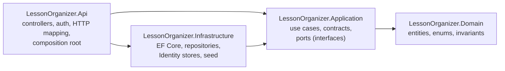
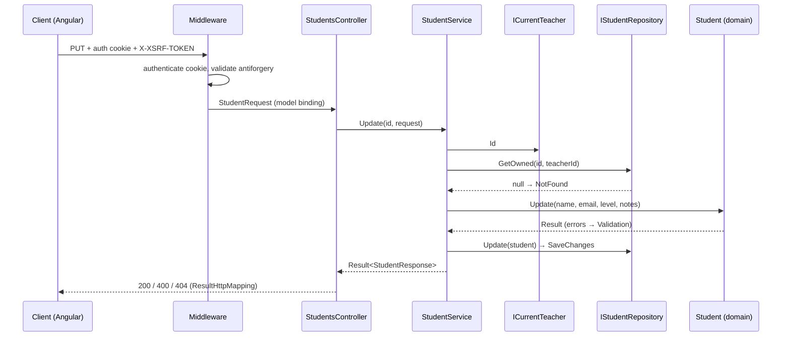

# Backend Architecture

How the backend is split, what each part may depend on, and how a request flows. Versions are in [stack.md](stack.md); the data format is in [plan.md §3](plan.md#3-data-model); the Angular app is in [frontend-architecture.md](frontend-architecture.md).

## What the exercise asks

| Exercise wording | Where it lands |
|---|---|
| "adhering to Clean Architecture principles" · "separation of concerns and component independence" | Four projects with a one-way dependency rule, checked by project references |
| "Data layer: … interacts with the data and provides the necessary CRUD operations" | `Infrastructure` (EF Core `DbContext` + repositories over SQL Server) |
| "Business logic layer: … all of the business rules and validation" · "independent of the data layer and the API" | `Domain` (invariants) + `Application` (use cases, ownership). Neither references `Infrastructure` or `Api`. |
| "ASP.NET Web API with endpoints … appropriate HTTP verbs, parameters, and return values" | `Api` controllers |
| "a second API … user creation, user login, and authorized and non-authorized endpoints" | `AuthController` (`/api/auth`), public and protected actions |
| "unit tests for all components … data access layer, business logic layer, and API endpoints" | One unit test project per layer, including controllers, plus HTTP integration tests (see [Tests](#tests)) |
| "using Test-Driven Development (TDD) methodologies" · "Use of TDD is preferable" | Every behavior starts as a failing test (see [How tests are written](#how-tests-are-written-tdd)) |

## Layers



Arrows are project references. Nothing points back.

| Project | May reference | Must not reference |
|---|---|---|
| Domain | BCL only | everything else |
| Application | Domain | ASP.NET Core, Identity, EF Core, Infrastructure, Api |
| Infrastructure | Application, Domain, EF Core SQL Server, Identity EF Core stores, `Microsoft.AspNetCore.App` (for `SignInManager`) | Api |
| Api | Application, Infrastructure | — |

Application owns the interfaces (ports); Infrastructure and Api implement them. That is what keeps the business logic independent of storage and HTTP: replacing SQL Server or EF Core touches only Infrastructure. Application tests run against in-memory fakes of the same ports, with no database.

## Projects

### `LessonOrganizer.Domain`

Entities that cannot be put in an invalid state.

```
Common/      Result<T>, Error (kind: Validation | NotFound | Conflict; field; message),
             TextField, EmailFormat (shared validation helpers)
Students/    Student, EnglishLevel
LessonPlans/ LessonPlan, LessonPlanStatus
```

- Entities are created and changed only through methods: `Student.Create(...)`, `student.Update(...)`, `LessonPlan.Create(...)`, `plan.ChangeStatus(...)`.
- These methods trim text, check required fields and length limits, and return `Result<T>` with validation errors instead of throwing.
- `LessonPlan.Create` always starts at `ToPrepare`.
- Enum values are checked with `Enum.IsDefined`. The JSON converter rejects unknown names, but it accepts numbers (`"englishLevel": 99`), so the domain is the real guard.
- `Result<T>` lives here because the domain is the first to produce errors; Application reuses it.
- There is no user entity: accounts belong to Identity (Infrastructure). Registration rules (name, email format, password length) are checked in `AuthService` with the same `TextField` and `EmailFormat` helpers.
- Each entity has a private parameterless constructor for EF Core to materialize it; it holds no rules and is not callable from other code.

### `LessonOrganizer.Application`

Use cases and the contracts the API speaks.

```
Abstractions/  IUserAccounts, IStudentRepository, ILessonPlanRepository,
               ICurrentTeacher
Auth/          AuthService, RegisterRequest, LoginRequest, UserResponse, LoginOutcome
Students/      StudentService, StudentRequest, StudentResponse
LessonPlans/   LessonPlanService, LessonPlanRequest, LessonPlanResponse,
               ChangeLessonPlanStatusRequest, LessonPlanFilter
```

- One service per aggregate. Services are concrete classes; controllers depend on them directly (no interface for a single implementation).
- `ICurrentTeacher.Id` is the only source of the teacher id. Services never accept it from a request.
- Ownership: a resource that does not exist or belongs to another teacher gives `NotFound`. A referenced student that is missing or foreign gives `Validation` on `studentId` (plan A3).
- Deleting a student with lesson plans gives `Conflict`.
- Requests and responses are records. Mapping from entity to response is a static method next to the response (`StudentResponse.From(student, lessonPlanCount)`).

#### Repository contracts (the data layer's CRUD)

The exercise asks for a data access layer that "provides the necessary CRUD operations for the API endpoints". These interfaces are that contract; Infrastructure implements them. All methods are async.

| Interface | Create | Read | Update | Delete |
|---|---|---|---|---|
| `IStudentRepository` | `Add(student)` | `ListByTeacher(teacherId, search)`, `GetOwned(id, teacherId)` | `Update(student)` | `TryDelete(id, teacherId)` → false if it has lesson plans |
| `ILessonPlanRepository` | `Add(plan)` | `ListByTeacher(teacherId, studentId?, status?)`, `GetOwned(id, teacherId)`, `CountByStudents(studentIds)` | `Update(plan)` | `Delete(id)` |
| `IUserAccounts` | `Create(name, email, password)` → Conflict if the email is taken | `FindById(id)`, `CheckPassword(email, password)` → `LoginOutcome` (succeeded, invalid, locked out) | — (no profile editing in scope) | — (no account deletion in scope) |

Business rules stay in Application: services check ownership, the referenced student and "has lesson plans" first, and return the right outcome. The database guards the same integrity with foreign keys and the unique email index. That guard only matters in a race: `TryDelete` turns a foreign key violation into `false` (409), and `IUserAccounts.Create` turns a duplicate email into Conflict (409).

`IUserAccounts` is the port over Identity. Application never sees `UserManager`, `SignInManager` or `ApplicationUser`; it gets `UserResponse` records back.

### `LessonOrganizer.Infrastructure`

Everything that touches files or third-party code.

```
Persistence/                LessonOrganizerDbContext (IdentityUserContext<ApplicationUser, Guid>)
Persistence/Configurations/ StudentConfiguration, LessonPlanConfiguration, ApplicationUserConfiguration
Persistence/                DesignTimeDbContextFactory (for dotnet ef; no secrets)
Persistence/Migrations/     EF Core migrations (generated, committed)
Repositories/               EfStudentRepository, EfLessonPlanRepository
Identity/                   ApplicationUser, IdentityUserAccounts (IUserAccounts over UserManager/SignInManager)
Seed/                       DemoDataSeeder
InfrastructureServiceCollectionExtensions.AddInfrastructure(...)
```

- EF Core maps the domain entities through the configuration classes (table names, keys, lengths, enum-to-string, foreign keys with no cascade, indexes). Domain stays free of EF types.
- `IdentityUserContext` creates only the user tables (no roles).
- `DbContext` and repositories are scoped; each repository write calls `SaveChangesAsync` once.
- Foreign key violations are recognised by SQL Server error number 547; duplicate keys by 2601/2627.
- `IdentityUserAccounts.CheckPassword` uses `SignInManager.CheckPasswordSignInAsync(user, password, lockoutOnFailure: true)`, which counts failures and applies lockout without issuing a cookie; for an unknown email it verifies against a fixed dummy hash so timing does not reveal the account.

### `LessonOrganizer.Api`

HTTP only: no business rules.

```
Controllers/  AuthController, StudentsController, LessonPlansController
Http/         ResultHttpMapping (Result → IActionResult)
Security/     ClaimsCurrentTeacher (ICurrentTeacher from the NameIdentifier claim),
              Identity cookie, antiforgery and rate-limit setup
wwwroot/      Angular build output, copied in by the Dockerfile (not committed)
Program.cs    composition root: migrations and seed at startup when configured,
              static files + MapFallbackToFile("index.html") for the Angular routes
```

- After `AuthService` accepts a login, `AuthController` issues the cookie with `SignInManager.SignInAsync`; issuing cookies is HTTP work, so it stays in Api.

- Controllers: read input, call one service method, map the result. No `try/catch` per action.
- `ResultHttpMapping`: success → 200/201 (+ `Location`)/204; `Validation` → 400 `ValidationProblemDetails`; `NotFound` → 404 `ProblemDetails`; `Conflict` → 409 `ProblemDetails`.
- Malformed JSON, missing required fields and unknown enum values are rejected by `[ApiController]` model binding with 400 before reaching a service.
- Unexpected exceptions → 500 `ProblemDetails` through the built-in exception handler, logged as JSON.

## Request flow

Example: `PUT /api/students/{id}` by a logged-in teacher.



## Where each rule lives

| Rule | Layer |
|---|---|
| Required, trim, length, email format, initial status | Domain |
| Teacher id from the logged-in user | Api (`ClaimsCurrentTeacher`) → Application (`ICurrentTeacher`) |
| Ownership → 404, foreign student → 400, delete with plans → 409 | Application |
| Registration rules (name, email format, password 8–128) | Application (`AuthService`) |
| Unique user email | Identity check + unique index in SQL Server |
| Foreign keys | Application check (message) + SQL Server constraint (guarantee) |
| Sorting, filtering, search | Application asks; Infrastructure executes in SQL |
| JSON shape, enum names, date format | Api (model binding) |
| Column types, lengths, enum storage | Infrastructure (EF configurations, migrations) |
| Password hashing, lockout, security stamp | Infrastructure (Identity) behind `IUserAccounts` |
| 401, CSRF, rate limit, auth cookie | Api middleware and `AuthController` |

## Tests

One test project per layer, all run by `dotnet test`. Tests use named fakes, never a mocking library.

| Project | Kind | What it covers | Fakes / real parts |
|---|---|---|---|
| `Domain.Tests` | unit | invariants of `User`, `Student`, `LessonPlan` | none needed |
| `Application.Tests` | unit | services: ownership, 404/409/400 outcomes, filters, auth rules | `InMemoryStudentRepository`, `InMemoryLessonPlanRepository`, `InMemoryUserAccounts`, `FixedCurrentTeacher` |
| `Infrastructure.Tests` | unit (data access layer) | migrations, repositories and `IdentityUserAccounts`: persistence across contexts, foreign keys, unique email, lockout, sorting, search with wildcards, seed | real SQL Server from Testcontainers, one container per test run, a new database per test created by the migrations |
| `Api.Tests` | unit | controllers: each action returns the right result (200/201 + `Location`/204, 400 `ValidationProblemDetails`, 404, 409); `ResultHttpMapping`; `ClaimsCurrentTeacher` reads the id from the claim | controllers built directly with the real services, the in-memory fakes and `FixedCurrentTeacher`; no HTTP, no host, no database |
| `Api.IntegrationTests` | integration | full HTTP: auth cookie, lockout, 401, CSRF, rate limit, model binding (malformed JSON, unknown enum), JSON shape, isolation between two teachers, SPA fallback not answering `/api/...` | `WebApplicationFactory` with a Testcontainers SQL Server, a new database per test class |

`Infrastructure.Tests` and `Api.IntegrationTests` need Docker running. The other three run anywhere.

Unit tests on controllers answer "unit tests for … API endpoints" directly; integration tests cover what only exists with the whole pipeline running (middleware, cookies, serialization).

Naming: `Method_Scenario_ExpectedResult`, e.g. `Delete_StudentHasLessonPlans_ReturnsConflict`.

### How tests are written (TDD)

Same cycle for backend and frontend, one behavior at a time:

1. **Red:** write the test for the next behavior from the acceptance criteria ([plan.md §6](plan.md#6-acceptance-criteria)). Run it and confirm it fails **for the expected reason** (missing behavior, not a compile error or a broken setup).
2. **Green:** write the least code that makes it pass. Run the whole project's tests.
3. **Refactor:** clean names and duplication with all tests green. Run again.

Evidence for the presentation:
- Red and green are committed separately when practical (`test: …` then `feat: …`), so the history shows the test came first.
- Each stage records the failing run and the passing run (command and summary) in `docs/ai/AI_LOG.md`.
- Order inside a backend feature: Domain → Application → Infrastructure → controller unit tests → HTTP integration tests.
