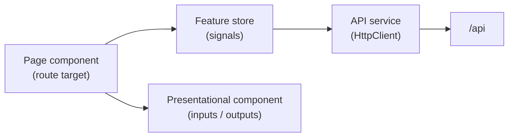

# Frontend Architecture

How the Angular app is organized. Versions and libraries are in [stack.md](stack.md#frontend); the API it calls is in [plan.md §5](plan.md#5-api-contracts); required screens and behaviors are in [requirements.md §5](requirements.md#5-user-interface-behavior).

## What the exercise asks

| Exercise wording | Where it lands |
|---|---|
| "integrate the backend you just built with a frontend framework" | Angular 22 app calling `/api` on the same origin |
| "responsive and user-friendly" | Angular Material, phone layouts, loading/empty/error states (see [UI states](#ui-states)) |
| "Implement CRUD operations associated with the implemented use case" | Students and lesson plans: list, details, create, edit, delete, status change |
| "Structured code: Organize your components and state cleanly" | Feature folders; one store per feature; pages vs presentational components; only API services touch HTTP |
| "no warnings in the browser console" (optional, desired) | Checked in stage 12 |
| "unit tests for all components of the application" | Stores, guard, interceptor, validators and main screens (see [Tests](#tests)) |

## Folders

Organized by feature. Everything about students lives in `features/students`.

```
frontend/src/app/
├── app.config.ts            providers: router, HttpClient + XSRF + interceptor, Material, initializer
├── app.routes.ts            top-level routes, lazy feature routes
├── core/
│   ├── auth/                auth.store.ts, auth.api.ts, auth.guard.ts, guest.guard.ts
│   ├── http/                unauthorized.interceptor.ts, problem-details.ts (error parsing)
│   └── layout/              shell.component (toolbar, nav, user menu, router outlet)
├── shared/
│   ├── confirm-dialog/      generic "Are you sure?" MatDialog
│   ├── empty-state/         icon + message + optional action
│   ├── labels/              english-level.pipe, lesson-plan-status.pipe
│   ├── dates/               lesson-date.ts (yyyy-MM-dd ↔ local Date)
│   └── forms/               server-errors.ts (ValidationProblemDetails → form control errors)
└── features/
    ├── auth/
    │   ├── login.page
    │   └── register.page
    ├── students/
    │   ├── students.routes.ts
    │   ├── students.api.ts          HttpClient calls, typed contracts
    │   ├── students.store.ts        signals: list, selected, loading, saving
    │   ├── student.model.ts         StudentResponse, StudentRequest, EnglishLevel
    │   ├── student-list.page        search box + list
    │   ├── student-details.page     student + their lesson plans + "New lesson plan"
    │   ├── student-form.page        create and edit
    │   └── components/              student-table, student-cards, student-form (presentational)
    └── lesson-plans/
        ├── lesson-plans.routes.ts
        ├── lesson-plans.api.ts
        ├── lesson-plans.store.ts
        ├── lesson-plan.model.ts     LessonPlanResponse, LessonPlanRequest, LessonPlanStatus
        ├── lesson-plan-list.page    filters + list + inline status change
        ├── lesson-plan-form.page    create and edit
        └── components/              lesson-plan-table, lesson-plan-cards, lesson-plan-filters,
                                     lesson-plan-form, status-select (presentational)
```

Names like `.page` and `.store.ts` above show the role of each file; exact file and class naming follows the Angular 22 style guide (checked with the Angular skills at stage 9). One component per file.

## Kinds of code and what each may do



| Kind | Does | Does not |
|---|---|---|
| **Page** (`*.page`) | Reads route params and query params, calls store methods, navigates, opens dialogs and snackbars, passes signals down | Call `HttpClient`; hold lists of its own |
| **Presentational** (`components/`) | Renders inputs, emits outputs, owns its form controls | Inject stores, services or the router |
| **Store** (`*.store.ts`) | Holds state as signals (`items`, `selected`, `loading`, `saving`), exposes `load`, `create`, `update`, `remove`, `changeStatus`; returns the outcome to the page | Navigate or show UI |
| **API service** (`*.api.ts`) | One method per endpoint, typed with the model files | Keep state |
| **Models** (`*.model.ts`) | TypeScript types mirroring the backend contracts; enums as string unions | Contain logic |

Stores are `providedIn: 'root'`. Components use `ChangeDetectionStrategy.OnPush` and signal inputs/outputs.

## Routes

| Path | Page | Access |
|---|---|---|
| `/login` | Login (`?returnUrl=` after a 401; message after registering) | guests only |
| `/register` | Register, then go to `/login` (plan A9) | guests only |
| `/` | redirect to `/lesson-plans` | — |
| `/lesson-plans` | All my lesson plans; `?studentId=&status=` | logged in |
| `/lesson-plans/new` | Create; `?studentId=` preselects the student | logged in |
| `/lesson-plans/:id/edit` | Lesson plan details and edit (title, description, student, date) | logged in |
| `/students` | My students; `?search=` | logged in |
| `/students/new` | Create | logged in |
| `/students/:id` | Details + their lesson plans + "New lesson plan" | logged in |
| `/students/:id/edit` | Edit | logged in |
| `**` | redirect to `/lesson-plans` | — |

Feature routes are lazy-loaded. `authGuard` sends guests to `/login?returnUrl=…`; `guestGuard` sends logged-in users away from login/register. After login, `returnUrl` is followed only if it is an app path (starts with `/` and not `//`); anything else goes to `/lesson-plans`, so a crafted link cannot send the user to another site.

## Navigation

Top `mat-toolbar` inside the shell: app name, "Lesson plans", "Students", and a user menu with the teacher's name and "Log out". At phone width the two links move into a menu button.

## Data flow

**Reading.** Each list page reads its filters from the URL and calls `store.load(filters)`. Changing a filter or the search box updates the query params (`replaceUrl`, search debounced 300 ms), which triggers the load. Filters survive refresh and the back button.

**Writing.**
- Create, edit, delete: the store calls the API; on success the page shows a snackbar and navigates (back to the list or details). The list reloads from the server, which owns sorting and filtering.
- Status change: done inline from the lesson plan list and the student details page (`PATCH /api/lesson-plans/{id}/status`). The store replaces that one item with the response; no reload. The edit form does not touch the status, matching the API.
- `saving` is true while a write is in flight; submit buttons and the status select are disabled, so nothing is sent twice.

**Errors** (parsed from ProblemDetails in `core/http`):

| Response | What the user sees |
|---|---|
| 400 with field errors | Messages under the matching form fields (`server-errors.ts`), plus a general message for unknown fields |
| 404 | Snackbar "Not found"; go back to the list |
| 409 | Snackbar with the server's message (e.g. student has lesson plans); stay on the page |
| 401 | Interceptor clears the user and goes to `/login?returnUrl=…` |
| 0 / 5xx | Snackbar "Something went wrong. Try again." |

## Authentication

- `AuthStore` holds `currentUser` (signal) and exposes `login`, `logout`, `register`, `isLoggedIn`.
- On app start, an initializer calls `GET /api/auth/csrf` (sets the `XSRF-TOKEN` cookie) and then `GET /api/auth/me` to restore the session. 401 there means "not logged in", not an error.
- `HttpClient` sends the token as `X-XSRF-TOKEN` on unsafe requests (`withXsrfConfiguration`).
- After login and after logout, the app calls `/api/auth/csrf` again, because antiforgery tokens are tied to the user.
- Before every login and register, and after any 401, the app also calls `/api/auth/csrf`: a token issued while a session existed is refused once that session expires or ends in another tab.
- A 400 whose ProblemDetails `type` is `urn:lesson-organizer:problem:invalid-xsrf-token` means a stale token: the interceptor fetches a new one and retries the request once; a second failure is shown as the generic error.
- Logout: `POST /api/auth/logout`, then a full page load of `/login`. This drops every store's state, so the next teacher never sees the previous teacher's data, not even for a moment.

## UI states

| State | Behavior |
|---|---|
| Loading | `mat-progress-bar` under the toolbar while a store is loading |
| No students yet | Students list: empty state with "Add your first student". Lesson plan list and form: "Create a student first" with a link to `/students/new` |
| No results for search or filters | Empty state "No results" with "Clear filters" |
| No lesson plans for a student | Empty state on details with "New lesson plan" |
| Delete | Confirmation dialog naming the record; deleting a student with plans shows the 409 message |
| Form validation | Required and max length mirroring the backend (150, 254, 2000, 5000), email format; messages under each field |
| Success | Snackbar ("Student saved", "Lesson plan deleted", "Status changed to Ready") |

## Display rules

- Enum labels through pipes: `ToPrepare` → "To prepare", `UpperIntermediate` → "Upper intermediate".
- `lessonDate` stays a `yyyy-MM-dd` string in models. `lesson-date.ts` converts to a local `Date` for the datepicker and display, never through `new Date('yyyy-MM-dd')`, which is parsed as UTC and can show the previous day.
- Lists: `mat-table` on wide screens, cards at phone width (CDK `BreakpointObserver`, `Handset`).

## Tests

Run with `npm test` (CLI default runner). Fakes are named classes (`FakeStudentsApi`, `FakeLessonPlansApi`, `FakeAuthApi`); HTTP-level tests use Angular's `HttpTestingController`. No mocking library.

| Target | What is checked |
|---|---|
| Stores | load sets items and loading; create/update/remove call the API and report outcomes; status change replaces one item; `saving` toggles |
| `authGuard`, `guestGuard` | redirects with `returnUrl`; logged-in users skip login |
| `unauthorizedInterceptor` | 401 clears the user and navigates to login; other errors pass through |
| `server-errors.ts`, `lesson-date.ts`, label pipes | field mapping; date conversion without day shifts; labels |
| Student form, lesson plan form | required and length messages; submit disabled while saving; server field errors shown; student preselected from `?studentId=` |
| Lesson plan list page | filters written to and read from the URL; empty states; inline status change disabled while saving |

Naming: `describe('<unit>')` + `it('<scenario> → <expected result>')`.
