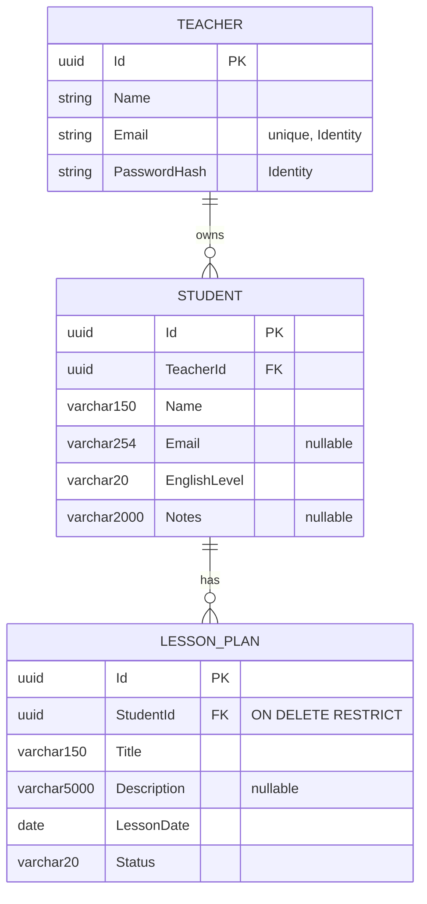

# Lesson Organizer — Implementation Plan

Status: **draft, awaiting approval**. No code has been written.

## 1. Understanding

A single-tenant-per-teacher planner. A teacher registers, logs in, keeps a list of private students, and plans lessons for them. Each lesson plan moves freely between `ToPrepare`, `Ready` and `Delivered`. Students never log in. The core concerns are strict per-teacher data isolation, clear validation, and a clean layered backend with tests written first.

## 2. Ambiguities and proposed resolutions

| # | Issue | Proposed resolution |
|---|---|---|
| A1 | Original requirements asked for a Portuguese UI, while the rest of the project is in English. | **Decided:** everything in English, UI included. Requirements updated. The UI maps enum values to friendly labels (`ToPrepare` → "To prepare"). |
| A2 | Teacher fields are not defined. | Registration takes `name`, `email`, `password`. Email is the login and must be unique (enforced by Identity). |
| A3 | Status code when the **referenced** student (on create/update of a lesson plan) does not exist or belongs to another teacher. The 404 rule covers the requested resource, not references. | **Decided:** return **400** with a field error on `studentId` ("Student not found"). Nonexistent and foreign students get the identical response, so nothing leaks. |
| A4 | Filtering lesson plans by another teacher's `studentId`. | **Decided:** return **200 with an empty list** (it is a filter, not a resource lookup). |
| A5 | Whitespace handling. | Trim `Name`, `Title`, `Email`; length limits apply after trimming. Empty optional strings (`Email`, `Notes`, `Description`) are stored as `null`. |
| A6 | Email "valid format" is loosely defined. | Use `System.Net.Mail.MailAddress` parsing plus a check that the parsed address equals the input; no regex of our own. |
| A7 | Student search: client or server side? | Server side, `GET /api/students?search=`, case-insensitive substring (`ILIKE`). |
| A8 | Sort order ties. | Lesson plans: `LessonDate` asc, then `Title`, then `Id`. Students: `Name` asc. Deterministic for tests. |
| A9 | Does registration sign the user in? | **Decided:** no. Registration only creates the account; the UI then sends the teacher to the login page. |
| A10 | Pagination is not mentioned. | Not implemented (data volume for one teacher is small). |
| A11 | Concurrent edits. | Last write wins. *(Optional: optimistic concurrency via Postgres `xmin`.)* |
| A12 | Race: a lesson plan is created while its student is being deleted. | The FK is `ON DELETE RESTRICT`; a resulting `DbUpdateException` is mapped to 409. |
| A13 | The original exercise asks for "a second API" for users. | `AuthController` (`/api/auth`) is that API, separate from the resource controllers, in the same host. |

## 3. Data model



- Teacher is the ASP.NET Core Identity user (`Teacher : IdentityUser<Guid>` with `Name`), living in Infrastructure. The domain only knows `TeacherId`.
- `LessonPlan` has **no** `TeacherId`; ownership is resolved through `Student`, as required. Every lesson plan query joins on the student's `TeacherId`.
- Enums stored as strings (readable data, safe to reorder).
- `LessonDate` is `DateOnly` → Postgres `date`.
- Ids are `Guid` v7 (`Guid.CreateVersion7()`): not enumerable, index-friendly.
- Indexes: `Students(TeacherId, Name)`, `LessonPlans(StudentId)`, `LessonPlans(LessonDate)`.

## 4. Architecture

```
src/
  LessonOrganizer.Domain          entities, enums, invariants. No dependencies.
  LessonOrganizer.Application     use cases, request/response contracts, repository interfaces, Result type.
  LessonOrganizer.Infrastructure  EF Core DbContext, Identity stores, repositories, migrations, seed.
  LessonOrganizer.Api             controllers, auth config, Result → HTTP mapping, composition root.
tests/
  LessonOrganizer.Domain.Tests              unit
  LessonOrganizer.Application.Tests         unit, with named in-memory fakes
  LessonOrganizer.Infrastructure.Tests      repositories against real Postgres (Testcontainers)
  LessonOrganizer.Api.IntegrationTests      HTTP end to end (WebApplicationFactory + Testcontainers)
frontend/                                    Angular
```

Dependency rule: `Api → Infrastructure → Application → Domain`; `Api → Application`. Domain and Application reference no framework packages except the BCL.

**Key choices (kept proportional):**
- **Domain** entities expose `Create`/`Update`/`ChangeStatus` methods that enforce invariants (trim, length, required) and return validation errors instead of throwing.
- **Application** has one service per aggregate (`StudentService`, `LessonPlanService`). They take the current `TeacherId` from an `ICurrentTeacher` abstraction, check ownership, and return `Result<T>` with error kinds `Validation`, `NotFound`, `Conflict`.
- **Repositories:** `IStudentRepository`, `ILessonPlanRepository` (specific methods, no generic repository). They keep Application independent of EF and testable with fakes.
- **API:** thin controllers; one mapper from `Result` to `200/201/204`, `ValidationProblemDetails` (400), `ProblemDetails` (404/409).
- **Contracts:** request/response records in Application, used directly by the API. Entities are never serialized.
- **Not used**, because there's no concrete need: MediatR, AutoMapper, FluentValidation, CQRS split, generic repository, mocking library (named fakes instead).

**Packages:** EF Core + Npgsql, ASP.NET Core Identity (EF stores), xUnit, `Microsoft.AspNetCore.Mvc.Testing`, `Testcontainers.PostgreSql` (needed: tests must hit real Postgres for `ILIKE`, `date`, and `RESTRICT` behavior). *(Optional: Scalar UI for browsing the built-in OpenAPI document during the demo.)*

### Authentication approach

**ASP.NET Core Identity with cookie authentication**, same-origin with the Angular app.

| Concern | Decision | Why |
|---|---|---|
| Password storage | Identity `PasswordHasher` (PBKDF2, salted) | Standard, no custom crypto. |
| Session credential | Identity application cookie: `HttpOnly`, `Secure`, `SameSite=Strict`, 8 h sliding expiration | JavaScript cannot read it (XSS cannot steal it), unlike a JWT in `localStorage`. |
| Logout | `POST /api/auth/logout` → `SignOutAsync` deletes the cookie | Real server-driven logout; JWTs can't be revoked without extra infrastructure. |
| Session invalidation | Identity security stamp validation | A password change invalidates existing cookies. |
| CSRF | `SameSite=Strict` **plus** ASP.NET Core antiforgery, using Angular's built-in XSRF support (`XSRF-TOKEN` cookie → `X-XSRF-TOKEN` header) | Cookies are sent automatically, so unsafe methods need CSRF protection. Built into both frameworks, no extra library. |
| API behavior | Cookie redirects disabled; unauthenticated → **401**, never a 302 to a login page | Correct API semantics; the SPA handles 401. |
| Brute force | Identity lockout (5 failures → 5 min) + built-in rate limiter on `/api/auth/login` and `/register` | Built in. |
| Enumeration | Login failure returns a generic "Invalid email or password" | Doesn't reveal which accounts exist. |
| Teacher id | Read only from the `NameIdentifier` claim via `ICurrentTeacher` | Never from the body or route. |
| Dev topology | Angular dev server proxies `/api` to the backend | Same origin, so no CORS and the cookie works. |

Why not JWT: no second client (mobile, third parties) needs it. Cookies give simpler and safer storage and real logout for a browser-only app.

## 5. API contracts

All JSON. Enums serialized as strings. Errors use RFC 9457 ProblemDetails.

### Auth — `/api/auth`

| Method | Path | Auth | Request | Responses |
|---|---|---|---|---|
| GET | `/api/auth/csrf` | public | — | 204, sets `XSRF-TOKEN` cookie |
| POST | `/api/auth/register` | public | `{ name, email, password }` | 201 `TeacherResponse` (no session started) · 400 validation/weak password · 409 email taken |
| POST | `/api/auth/login` | public | `{ email, password }` | 200 `TeacherResponse` · 401 invalid credentials · 429 rate limited |
| POST | `/api/auth/logout` | required | — | 204 |
| GET | `/api/auth/me` | required | — | 200 `TeacherResponse` · 401 |

`TeacherResponse = { id, name, email }`

### Students — `/api/students` (all require auth)

| Method | Path | Request | Responses |
|---|---|---|---|
| GET | `/api/students?search=` | — | 200 `StudentResponse[]` (by name) |
| GET | `/api/students/{id}` | — | 200 `StudentResponse` · 404 |
| POST | `/api/students` | `StudentRequest` | 201 + `Location` · 400 |
| PUT | `/api/students/{id}` | `StudentRequest` | 200 `StudentResponse` · 400 · 404 |
| DELETE | `/api/students/{id}` | — | 204 · 404 · 409 has lesson plans |

`StudentRequest = { name, email?, englishLevel, notes? }`
`StudentResponse = { id, name, email, englishLevel, notes, lessonPlanCount }`

### Lesson plans — `/api/lesson-plans` (all require auth)

| Method | Path | Request | Responses |
|---|---|---|---|
| GET | `/api/lesson-plans?studentId=&status=` | — | 200 `LessonPlanResponse[]` (date asc) |
| GET | `/api/lesson-plans/{id}` | — | 200 · 404 |
| POST | `/api/lesson-plans` | `LessonPlanRequest` | 201 + `Location`, status `ToPrepare` · 400 (incl. unknown/foreign student) |
| PUT | `/api/lesson-plans/{id}` | `LessonPlanRequest` | 200 · 400 · 404 — does not change status |
| PATCH | `/api/lesson-plans/{id}/status` | `{ status }` | 200 · 400 invalid status · 404 |
| DELETE | `/api/lesson-plans/{id}` | — | 204 · 404 |

`LessonPlanRequest = { studentId, title, description?, lessonDate }` (`lessonDate` as `yyyy-MM-dd`)
`LessonPlanResponse = { id, studentId, studentName, title, description, lessonDate, status }`

Student details page reuses `GET /api/lesson-plans?studentId={id}`; no nested endpoint is needed.

## 6. Acceptance criteria

**Auth**
- Registering with a valid name, email and password returns 201 without starting a session; a following login with those credentials succeeds.
- Registering with an existing email returns 409; with a weak password or invalid email, 400.
- Valid login returns 200 and sets an `HttpOnly` cookie; wrong password returns 401 with a generic message.
- After logout, `GET /api/auth/me` returns 401.
- Every student and lesson plan endpoint returns 401 without a session.
- An unsafe request without a valid XSRF token is rejected.

**Students**
- Create/read/update/delete work for the owner and data survives an application restart (new `DbContext`).
- Name empty, whitespace-only, or > 150 chars → 400. Email > 254 or invalid → 400. Notes > 2000 → 400. Unknown `englishLevel` → 400.
- Duplicate names/emails across students are accepted.
- Deleting a student with lesson plans → 409 with a clear message, and nothing is deleted.
- Search returns case-insensitive name matches only from the teacher's own students.

**Lesson plans**
- A new plan has status `ToPrepare`.
- Title empty, whitespace-only, or > 150 → 400. Description > 5000 → 400. Missing date → 400. Unknown status → 400.
- Past dates are accepted.
- Nonexistent `studentId` and another teacher's `studentId` both → 400 with the same message, on create and on update.
- Status can move between any two values, including backwards.
- List is sorted by date ascending; filters by student and status combine.

**Isolation (teacher A vs teacher B)**
- B gets 404 on GET/PUT/DELETE of A's students and lesson plans, and on PATCH status of A's lesson plans.
- B's lists and searches never include A's records.
- B can't attach a lesson plan to A's student (400).

**Frontend**
- Workflows 1–3 from the requirements work end to end.
- Empty states for no students, no results, and the "create a student first" guidance.
- Submit buttons disabled while a request is in flight; loading, success and error feedback visible.
- Usable at phone width; no errors or warnings in the browser console.

**Demo**
- Two seeded teachers, each with students and plans in all three statuses; seed runs only in `Development`/`Demo` and is safe to run twice.

## 7. Implementation stages

Each backend stage follows red → green → refactor, with the failing run and the passing run both recorded. Each stage ends with a commit and a verification command.

| # | Stage | Done when |
|---|---|---|
| 0 | Scaffold: solution, projects and references, `Directory.Build.props` (nullable, warnings as errors), `docker-compose.yml` (Postgres), `.gitignore`, `CLAUDE.md`, README skeleton, `docs/ai/AI_LOG.md` | `dotnet build` and `dotnet test` pass; `docker compose up` starts Postgres |
| 1 | Domain: `Student`, `LessonPlan`, enums, invariants | Domain tests green |
| 2 | Application: `StudentService` with fakes (ownership, 404, 409) | Application tests green |
| 3 | Application: `LessonPlanService` (foreign student, status, filters) | Application tests green |
| 4 | Infrastructure: DbContext, mappings, initial migration, repositories | Repository tests on Testcontainers green (sorting, `ILIKE`, `RESTRICT`, persistence) |
| 5 | API auth: Identity, cookie, antiforgery, rate limit, `/api/auth/*` | Auth integration tests green |
| 6 | API students + isolation tests | Integration tests green |
| 7 | API lesson plans + isolation tests | Integration tests green |
| 8 | Seed data (dev/demo only, idempotent) | Seed test runs twice with no duplicates |
| 9 | Angular: scaffold, proxy, auth pages, route guard, 401 interceptor, XSRF config | Login/register/logout work against the API |
| 10 | Angular: students list, search, form, details, delete confirmation | Workflow 3 works |
| 11 | Angular: lesson plans list, filters, form, status change, delete | Workflows 1 and 2 work |
| 12 | Polish: responsiveness, console clean, README (setup, run, test, credentials), `docs/ai/genai-exercise.md` | Full test suite run and output recorded; manual check of workflows 1–3 |

*(Optional)* A few Angular unit tests for the auth guard, interceptor and form validators in stage 9–11.

## 8. Cost

None. Everything runs locally (Docker Postgres, local .NET and Node).
