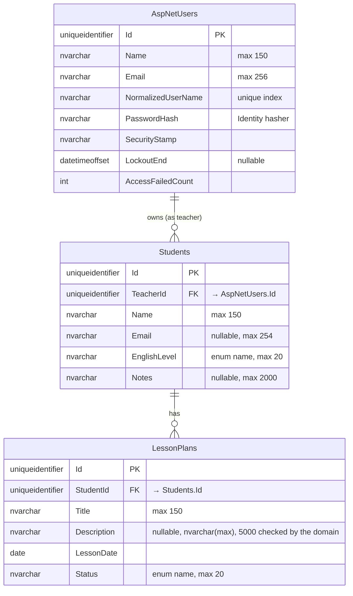

# Lesson Organizer — Implementation Plan

Status: **draft, awaiting approval**. No code has been written.

## 1. Understanding

A single-tenant-per-teacher planner. A teacher registers, logs in, keeps a list of private students, and plans lessons for them. Each lesson plan moves freely between `ToPrepare`, `Ready` and `Delivered`. Students never log in. The core concerns are strict per-teacher data isolation, clear validation, and a clean layered backend with tests written first.

## 2. Ambiguities and proposed resolutions

| # | Issue | Proposed resolution |
|---|---|---|
| A1 | Original requirements asked for a Portuguese UI, while the rest of the project is in English. | **Decided:** everything in English, UI included. Requirements updated. The UI maps enum values to friendly labels (`ToPrepare` → "To prepare"). |
| A2 | Teacher account fields are not defined. | The account is a user (the exercise's term); every user is a teacher. Registration takes `name`, `email`, `password`. Email is the login and must be unique, compared case-insensitively; a unique index in the database enforces it (see §3). |
| A3 | Status code when the **referenced** student (on create/update of a lesson plan) does not exist or belongs to another teacher. The 404 rule covers the requested resource, not references. | **Decided:** return **400** with a field error on `studentId` ("Student not found"). Nonexistent and foreign students get the identical response, so nothing leaks. |
| A4 | Filtering lesson plans by another teacher's `studentId`. | **Decided:** return **200 with an empty list** (it is a filter, not a resource lookup). |
| A5 | Whitespace handling. | Trim `Name`, `Title`, `Email`; length limits apply after trimming. Empty optional strings (`Email`, `Notes`, `Description`) are stored as `null`. |
| A6 | Email "valid format" is loosely defined. | Use `System.Net.Mail.MailAddress` parsing plus a check that the parsed address equals the input; no regex of our own. |
| A7 | Student search: client or server side? | Server side, `GET /api/students?search=`, case-insensitive substring, done by SQL Server (`LIKE` under the default case-insensitive collation). `%`, `_` and `[` in the search text match literally. |
| A8 | Sort order ties. | Lesson plans: `LessonDate` asc, then `Title`, then `Id`. Students: `Name` asc, then `Id`. Deterministic for tests. |
| A9 | Does registration sign the user in? | **Decided:** no. Registration only creates the account; the UI then sends the teacher to the login page. |
| A10 | Pagination is not mentioned. | Not implemented (data volume for one teacher is small). |
| A11 | Concurrent edits. | Last write wins; no concurrency token. Two teachers never edit the same record, and one teacher editing in two tabs is out of scope. |
| A12 | Race: a lesson plan is created while its student is being deleted. | The foreign key decides. If the plan is saved first, the delete fails on the foreign key and returns 409, like the application check. If the delete wins, saving the plan fails on the foreign key and returns 500; accepted, it needs two requests within milliseconds on the same student. |
| A13 | The original exercise asks for "a second API" for users. | `AuthController` (`/api/auth`) is that API, separate from the resource controllers, in the same host. |

## 3. Data model

SQL Server, accessed with EF Core; users are stored by ASP.NET Core Identity. See [ADR 0003](decisions/0003-sql-server-ef-core-docker.md) for why.

### Tables

| Table | Holds | Indexes |
|---|---|---|
| `AspNetUsers` | Users (teachers), managed by Identity. `UserName` is set to the email. Other Identity columns (phone, two-factor, …) exist but are unused. | PK; unique on `NormalizedUserName`; `NormalizedEmail` |
| `AspNetUserClaims`, `AspNetUserLogins`, `AspNetUserTokens` | Created by `IdentityUserContext`; unused. No role tables. | — |
| `Students` | Students of each teacher | PK; `(TeacherId, Name)` |
| `LessonPlans` | Lesson plans of each student | PK; `(StudentId, LessonDate)` |
| `__EFMigrationsHistory` | Applied migrations | PK |

### Rules
- **Primary keys:** `Guid` v7 (`Guid.CreateVersion7()`), generated by the domain on creation; EF Core never generates them (`ValueGeneratedNever`). Not enumerable. SQL Server does not order `uniqueidentifier` by creation time, which only matters for index fragmentation at volumes far beyond this app.
- **Foreign keys:** enforced by the engine with `ON DELETE NO ACTION`; nothing cascades. The application still checks first, so the user gets a clear message: a lesson plan's student must exist and belong to the teacher (400), a student with lesson plans cannot be deleted (409).
- **Unique email:** Identity sets `UserName` to the email and keeps a unique index on `NormalizedUserName` (upper-cased), so uniqueness is case-insensitive and holds even for two registrations at the same moment.
- **Ownership:** `LessonPlans` has **no** `TeacherId`. Ownership is resolved through the student, as required: queries join `Students` and match `TeacherId`.
- **Users:** `ApplicationUser : IdentityUser<Guid>` with `Name`, in Infrastructure. Every user is a teacher: "user" names the account, "teacher" names the owner role, so `Students.TeacherId` holds an `AspNetUsers.Id`. Domain has no user entity; Application reaches accounts through `IUserAccounts`.
- **Mapping:** Fluent API configuration classes in Infrastructure map the domain entities `Student` and `LessonPlan`. Enums are stored as their names (`HasConversion<string>()`), so the tables are readable. Domain has no EF attributes or references.
- **Lengths:** column sizes match the domain limits; `Description` is `nvarchar(max)` because 5000 exceeds `nvarchar(4000)`, and the domain enforces 5000.
- **Concurrency:** last write wins (A11). Each repository call is one `SaveChanges`, which is one transaction.
- **Sorting and search:** done in SQL. Lesson plans: `LessonDate`, `Title`, `Id`. Students: `Name`, `Id`. The default collation is case-insensitive.
- **Schema changes:** EF Core migrations in `src/LessonOrganizer.Infrastructure/Persistence/Migrations`, committed. Applied at startup when `Database:MigrateOnStartup` is `true` (Development and the Docker demo), otherwise with `dotnet ef database update`.
- **Connection string:** `ConnectionStrings:LessonOrganizer`. In development it comes from user secrets; in Docker, from an environment variable built from `.env`. Never committed.

### Seed data

The exercise asks for "seeded data/credentials for demo purposes".

- **When:** at API startup, only when `Seed:DemoData` is `true` (set in `appsettings.Development.json` and in the Docker Compose file, `false` by default), and only when there are no users. A second start finds users and does nothing, so it never duplicates records and never brings back records the user deleted. To reset the demo, `docker compose down -v` (drops the database volume) and start again.
- **How:** users through Identity's `UserManager` (so passwords are hashed like any registration; no hash is stored in source), students and lesson plans through the same domain factories and repositories as the app, so seeded data passes the same validation.
- **Dates:** relative to the seed day, so the demo always has past and upcoming lessons.
- **Credentials:** documented in the README.

| User (teacher) | Password | Students | Lesson plans |
|---|---|---|---|
| Maria Silva — `maria@example.com` | `Demo1234!` | Ana (Intermediate), Bruno (Beginner), Carla (Advanced, no plans) | Ana: "Present perfect — conversation" (Delivered, −7 days), "Phrasal verbs at work" (Ready, +2 days); Bruno: "Greetings and introductions" (ToPrepare, +5 days) |
| John Smith — `john@example.com` | `Demo1234!` | David (Elementary), Emma (UpperIntermediate) | David: "Past simple stories" (Delivered, −3 days), "Ordering at a restaurant" (ToPrepare, +4 days); Emma: "Job interview practice" (Ready, +1 day) |

The data supports the demo workflows: Ana has plans in two statuses (workflows 1 and 2), deleting Ana is blocked (workflow 3), Carla can be deleted, and logging in as John shows none of Maria's data (isolation).

## 4. Architecture

Four projects (Domain, Application, Infrastructure, Api) with the dependency rule `Api → Infrastructure → Application → Domain` and `Api → Application`. Domain holds invariants, Application holds use cases, ownership and contracts, Infrastructure holds EF Core, the Identity stores and the seed, and Api holds HTTP only. No MediatR, AutoMapper, FluentValidation, CQRS split, generic repository or mocking library.

- Layers, folders, request flow, where each rule lives, and test projects: **[architecture.md](architecture.md)**.
- .NET 10 LTS, SDK pin, build settings, packages, Docker and commands: **[stack.md](stack.md)**.

### Authentication approach

**ASP.NET Core Identity with EF Core stores and its application cookie**, same-origin with the Angular app. See [ADR 0003](decisions/0003-sql-server-ef-core-docker.md).

| Concern | Decision | Why |
|---|---|---|
| Password storage | Identity's password hasher (PBKDF2, salted), through `UserManager` | Standard, no custom crypto. |
| Password rule | Minimum 8 characters (`RequiredLength = 8`, Identity's composition rules off), maximum 128 checked in `AuthService` | Simple; length beats composition rules. |
| Session credential | Identity application cookie: `HttpOnly`, `Secure`, `SameSite=Strict`, 8 h sliding expiration; claims user id (`NameIdentifier`), name, email and security stamp | JavaScript cannot read it (XSS cannot steal it), unlike a JWT in `localStorage`. |
| Logout | `POST /api/auth/logout` → `SignInManager.SignOutAsync` deletes the cookie | Server-driven logout; JWTs can't be revoked without extra infrastructure. |
| Session invalidation | The security stamp is in the cookie and revalidated every 30 minutes (Identity default). No feature in scope changes the stamp (no password change), so a cookie lasts until it expires or the user logs out. | Comes with Identity; ready if a password change is added. |
| Account lockout | 5 failed logins lock the account for 15 minutes (Identity lockout) | Stops password guessing on one account, even across IPs. |
| CSRF | `SameSite=Strict` **plus** ASP.NET Core antiforgery, using Angular's built-in XSRF support (`XSRF-TOKEN` cookie → `X-XSRF-TOKEN` header). The antiforgery cookies are `Secure` only on HTTPS requests (antiforgery refuses to run over HTTP with `SecurePolicy.Always`), so the plain-HTTP Docker demo works; the session cookie stays `Secure` always | Cookies are sent automatically, so unsafe methods need CSRF protection. Built into both frameworks, no extra library. |
| API behavior | Cookie redirects disabled; unauthenticated → **401**, never a 302 to a login page | Correct API semantics; the SPA handles 401. |
| Brute force | Built-in rate limiter on `/api/auth/login` and `/register` (fixed window, per IP), plus lockout | The rate limiter covers many accounts from one IP; lockout covers one account from many IPs. |
| Enumeration | Wrong password, unknown email and locked account all return the same "Invalid email or password"; an unknown email still runs a hash check against a fixed dummy hash | Doesn't reveal which accounts exist, by message or by response time. |
| Default deny | Authorization fallback policy requires an authenticated user; `[AllowAnonymous]` only on `csrf`, `register`, `login` and the Angular static files | A new endpoint is protected unless someone opens it on purpose. |
| Teacher id | Read only from the `NameIdentifier` claim via `ICurrentTeacher` | Never from the body or route. |
| Data protection keys | Persisted to a Docker volume in the demo | Cookies stay valid when the `app` container is recreated. |
| Topology | Development: Angular dev server proxies `/api` to the API. Docker: the API serves the built Angular files. | Same origin in both, so no CORS and the cookie works. |

Why not JWT: no second client (mobile, third parties) needs it. Cookies give simpler and safer storage and real logout for a browser-only app.

### Running it

| Mode | What runs where | Command |
|---|---|---|
| Demo (reviewers, presentation) | Docker Compose: `db` (SQL Server) + `app` (API serving Angular), `http://localhost:8080` | `docker compose up --build` |
| Development | `db` in Docker; API with `dotnet run`; Angular with `npm start` (hot reload) | `docker compose up -d db`, then the two commands |
| Tests | Domain, Application and controller unit tests need nothing; data-layer and HTTP integration tests start their own SQL Server with Testcontainers | `dotnet test` (Docker running) |

Details (images, ports, volumes, `.env`) are in [stack.md](stack.md#docker).

## 5. API contracts

All JSON. Enums serialized as strings. Errors use RFC 9457 ProblemDetails.

### Auth — `/api/auth`

| Method | Path | Auth | Request | Responses |
|---|---|---|---|---|
| GET | `/api/auth/csrf` | public | — | 204, sets `XSRF-TOKEN` cookie |
| POST | `/api/auth/register` | public | `{ name, email, password }` | 201 `UserResponse` (no session started) · 400 validation/weak password · 409 email taken |
| POST | `/api/auth/login` | public | `{ email, password }` | 200 `UserResponse` · 401 invalid credentials or locked out · 429 rate limited |
| POST | `/api/auth/logout` | required | — | 204 |
| GET | `/api/auth/me` | required | — | 200 `UserResponse` · 401 |

`UserResponse = { id, name, email }`

### Students — `/api/students` (all require auth)

| Method | Path | Request | Responses |
|---|---|---|---|
| GET | `/api/students?search=` | — | 200 `StudentResponse[]` (by name) |
| GET | `/api/students/{id}` | — | 200 `StudentResponse` · 404 |
| POST | `/api/students` | `StudentRequest` | 201 + `Location` · 400 |
| PUT | `/api/students/{id}` | `StudentRequest` | 200 `StudentResponse` · 400 · 404 |
| DELETE | `/api/students/{id}` | — | 204 · 404 · 409 has lesson plans |

`StudentRequest = { name, email?, englishLevel, notes? }`
`StudentResponse = { id, name, email, englishLevel, notes, lessonPlanCount }`

### Lesson plans — `/api/lesson-plans` (all require auth)

| Method | Path | Request | Responses |
|---|---|---|---|
| GET | `/api/lesson-plans?studentId=&status=` | — | 200 `LessonPlanResponse[]` (date asc) |
| GET | `/api/lesson-plans/{id}` | — | 200 · 404 |
| POST | `/api/lesson-plans` | `LessonPlanRequest` | 201 + `Location`, status `ToPrepare` · 400 (incl. unknown/foreign student) |
| PUT | `/api/lesson-plans/{id}` | `LessonPlanRequest` | 200 · 400 · 404 — does not change status |
| PATCH | `/api/lesson-plans/{id}/status` | `{ status }` | 200 · 400 invalid status · 404 |
| DELETE | `/api/lesson-plans/{id}` | — | 204 · 404 |

`LessonPlanRequest = { studentId, title, description?, lessonDate }` (`lessonDate` as `yyyy-MM-dd`)
`LessonPlanResponse = { id, studentId, studentName, title, description, lessonDate, status }`

Student details page reuses `GET /api/lesson-plans?studentId={id}`; no nested endpoint is needed.

## 6. Acceptance criteria

**Auth**
- Registering with a valid name, email and password returns 201 without starting a session; a following login with those credentials succeeds.
- Registering with an existing email (any letter case) returns 409; with a password under 8 characters or an invalid email, 400.
- The stored user has a password hash, never the plain password.
- Valid login returns 200 and sets an `HttpOnly` cookie; wrong password returns 401 with a generic message.
- Five wrong passwords lock the account for 15 minutes; a locked account gets the same 401 and message as a wrong password, even with the right password.
- After logout, `GET /api/auth/me` returns 401.
- Every student and lesson plan endpoint returns 401 without a session.
- An unsafe request without a valid XSRF token is rejected.

**Students**
- Create/read/update/delete work for the owner and data survives an application restart (a new `DbContext` reading the same database).
- Name empty, whitespace-only, or > 150 chars → 400. Email > 254 or invalid → 400. Notes > 2000 → 400. Unknown `englishLevel` → 400.
- Duplicate names/emails across students are accepted.
- Deleting a student with lesson plans → 409 with a clear message, and nothing is deleted.
- Search returns case-insensitive name matches only from the teacher's own students.

**Lesson plans**
- A new plan has status `ToPrepare`.
- Title empty, whitespace-only, or > 150 → 400. Description > 5000 → 400. Missing date → 400. Unknown status → 400.
- Past dates are accepted.
- Nonexistent `studentId` and another teacher's `studentId` both → 400 with the same message, on create and on update.
- Status can move between any two values, including backwards.
- List is sorted by date ascending; filters by student and status combine.

**Isolation (teacher A vs teacher B)**
- B gets 404 on GET/PUT/DELETE of A's students and lesson plans, and on PATCH status of A's lesson plans.
- B's lists and searches never include A's records.
- B can't attach a lesson plan to A's student (400).

**Frontend**
- Workflows 1–3 from the requirements work end to end.
- Empty states for no students, no results, and the "create a student first" guidance.
- Submit buttons disabled while a request is in flight; loading, success and error feedback visible.
- Usable at phone width; no errors or warnings in the browser console.

**Database**
- Migrations create the whole schema on an empty database.
- The foreign keys refuse deleting a student that has lesson plans and saving a lesson plan for a missing student, even when the service checks are bypassed.
- The unique index refuses a second user with the same email in another letter case.
- Search treats `%`, `_` and `[` as plain characters.

**Demo**
- Two seeded users (teachers) with separate students and plans covering all three statuses; the seed runs only when `Seed:DemoData` is `true` and the database has no users, and a second start adds nothing.
- On a machine with only Docker: `cp .env.example .env`, set the password, `docker compose up --build`, and the app works at `http://localhost:8080` with the demo users.
- Data and login sessions survive `docker compose restart`; `docker compose down -v` resets to a fresh seed.

## 7. Implementation stages

Each backend stage follows red → green → refactor, with the failing run and the passing run both recorded. Each stage ends with a commit and a verification command.

Detailed, task-by-task plans live in `docs/plans/`, each written just before it is executed:
1. [Backend core — stages 0–4](plans/2026-11-10-1-backend-core.md)
2. [Backend API — stages 5–8](plans/2026-11-10-2-backend-api.md)
3. [Frontend — stages 9–11](plans/2026-11-10-3-frontend.md)
4. [UI refresh — design system, light/dark theme, lesson plan board](plans/2026-11-10-4-ui-refresh.md) (human request after stage 11)
5. Delivery — stage 12
6. Security review — stage 13

| # | Stage | Done when |
|---|---|---|
| 0 | Scaffold as in [stack.md](stack.md) and [architecture.md](architecture.md): `global.json`, `Directory.Build.props`, `Directory.Packages.props`, `.editorconfig`, `.config/dotnet-tools.json` (`dotnet-ef`), solution, projects and references, README skeleton | `dotnet build` and `dotnet test` pass |
| 1 | Domain: `Student`, `LessonPlan`, enums, invariants | Domain tests green |
| 2 | Application: `StudentService` with fakes (ownership, 404, 409) | Application tests green |
| 3 | Application: `LessonPlanService` (foreign student, status, filters) | Application tests green |
| 4 | Infrastructure: `DbContext` (Identity user tables + students + lesson plans), Fluent configurations, first migration, EF Core repositories; `docker-compose.yml` with the `db` service | Repository tests on a Testcontainers SQL Server green (persistence across contexts, foreign keys, unique email, sorting, search with wildcards) |
| 5 | Auth: `IUserAccounts` over Identity, `AuthService` (register, login, lockout), cookie, antiforgery, rate limit, `/api/auth/*`, migrations at startup (`Database:MigrateOnStartup`) | Application, `AuthController` unit and auth integration tests green |
| 6 | API students: `ResultHttpMapping`, `StudentsController`, isolation tests | Controller unit tests and integration tests green |
| 7 | API lesson plans: `LessonPlansController`, isolation tests | Controller unit tests and integration tests green |
| 8 | Seed data (`Seed:DemoData`, empty database only), as in §3 | Seed test: runs on an empty database, second run adds nothing, both users can log in |
| 9 | Angular 22 as in [stack.md](stack.md#frontend): confirm Node support, Angular skills installed, scaffold, `ng add @angular/material`, proxy, auth pages, route guard, 401 interceptor, XSRF config | Login/register/logout work against the API |
| 10 | Angular: students list, search, form, details, delete confirmation | Workflow 3 works |
| 11 | Angular: lesson plans list, filters, form, status change, delete | Workflows 1 and 2 work |
| 12 | Docker demo: multi-stage `Dockerfile`, `app` service, `.dockerignore`, `.env.example`, data protection keys volume. Polish: responsiveness, console clean, README as below, `docs/ai/genai-exercise.md` | `docker compose down -v && docker compose up --build` gives the seeded app at `http://localhost:8080`; full test suite run and output recorded; manual check of workflows 1–3 in the Docker demo |
| 13 | Security review of the whole app against the checklist below; every finding fixed test-first or recorded as an accepted risk | `docs/security-review.md` written; regression tests green; README "Known limitations" updated |

Angular stages 9–11 follow [frontend-architecture.md](frontend-architecture.md) and include its tests (stores, guards, interceptor, helpers, forms, lesson plan list), written first like the backend.

### Security review (stage 13)

Done on the finished app, backend and frontend, by reading the code and running the tests; Claude Code's `/security-review` may be used as a second reader. Output: `docs/security-review.md` with one row per item: **OK** (with the test or code that proves it), **Fixed** (regression test written first, then the fix), or **Accepted risk** (why, and listed in the README "Known limitations").

| Area | Check |
|---|---|
| Authorization | Every endpoint requires a session by default (fallback policy); only `csrf`, `register`, `login` and the Angular static files are anonymous. A test lists all controller actions and fails if a new one is anonymous by accident. An unknown `/api/...` path returns 404, never the Angular `index.html`. |
| Data isolation | Teacher id only from the `NameIdentifier` claim; no request type has a `teacherId`. Teacher B gets 404 on every operation on A's data, and 400 when referencing A's student (integration tests). |
| Session cookie | `HttpOnly`, `Secure`, `SameSite=Strict`, 8 h sliding expiration; 401 instead of redirects; logout removes the cookie. |
| CSRF | Antiforgery validated on every unsafe method, `login` and `register` included; token refreshed after login and logout. |
| Passwords | Only the hash is stored; never logged or returned; length 8–128; same error and similar timing for unknown email, wrong password and locked account (verify against a fixed dummy hash when the email does not exist). |
| Brute force | Rate limiter on `login` and `register` returns 429; 5 failed logins lock the account for 15 minutes. Lockout lets anyone lock a known account for 15 minutes; accepted, and limited by the rate limiter. |
| Input | Length limits, enum checks (numeric values included), date format, request body size limit, malformed JSON → 400 without internal details. |
| Errors and logs | No stack traces or exception messages in responses outside `Development`; logs contain no passwords, hashes, cookies, tokens or connection strings. |
| Database | Queries only through EF Core (parameterized); no SQL built from strings. Connection string from user secrets or environment, never committed; `.env` git-ignored, `.env.example` has placeholders only. SQL Server port published on `127.0.0.1` only. The demo connects as `sa`: accepted risk for a local demo, listed in the README. |
| Transport and headers | `dotnet run` uses HTTPS; the Docker demo is plain HTTP on `localhost` only, where Chrome, Edge and Firefox accept `Secure` cookies (checked at stage 12); a real deployment puts TLS in front (accepted risk). `X-Content-Type-Options: nosniff`; no CORS policy (same origin). The `app` container runs as a non-root user. |
| Frontend | No `innerHTML` or `bypassSecurityTrust*`; no credentials in `localStorage`/`sessionStorage`; `returnUrl` accepted only if it is an app path (starts with `/`, not `//`), so login cannot redirect off-site. |
| Secrets and demo data | No secrets in the repository or the image; seed runs only when `Seed:DemoData` is `true` (off by default); demo passwords exist only in the README and the seed. Data protection keys live in a volume, not in the image. |
| Dependencies | Known-vulnerable package check (`dotnet list package --vulnerable`, `npm audit`) and base image updates query package feeds or registries, so the human runs or approves them; result recorded. |

### README contents

The exercise asks for "a README with setup instructions and any other documentation you deem necessary". The README is written for someone who has never seen the project and must run it in a few minutes. Sections, in order:

1. **What it is:** one paragraph and the user story (`requirements.md` §1).
2. **Screenshots:** lesson plan list on desktop and on a phone.
3. **Prerequisites:** Docker (Docker Desktop, or Docker Engine with Compose) for the demo. For development, also .NET SDK 10.0.4xx, Node LTS and npm (from [stack.md](stack.md)).
4. **Run it:** demo: `cp .env.example .env`, set the SQL Server password, `docker compose up --build`, open `http://localhost:8080`; reset with `docker compose down -v`. Development: `docker compose up -d db`, set the connection string with `dotnet user-secrets`, `dotnet run --project src/LessonOrganizer.Api`, and `npm install && npm start` in `frontend/`.
5. **Demo credentials:** the two seeded users and what each one has (`plan.md` §3 "Seed data").
6. **Tests:** `dotnet test` (with Docker running, for the SQL Server test containers), `npm test`, coverage commands, and what each test project covers.
7. **Architecture:** the layer diagram and a link to [architecture.md](architecture.md) and [frontend-architecture.md](frontend-architecture.md).
8. **API:** endpoint summary with a link to `plan.md` §5 (and the Scalar UI if adopted).
9. **Decisions:** links to the ADRs in `docs/decisions/`.
10. **AI usage:** links to `docs/ai/AI_LOG.md`, `docs/ai/prompts/` and `docs/ai/genai-exercise.md`.
11. **Known limitations:** from the security review: demo over plain HTTP on localhost, app connects as `sa`, last write wins, rate limiter per instance, lockout can be triggered by others.

A README skeleton with these headings is created at stage 0 and filled in as stages finish; stage 12 checks every command in it by running it.

## 8. Cost

None. Everything runs locally. SQL Server Developer edition is free. Docker Desktop is free for personal use, education and companies under 250 employees and USD 10 million revenue; a machine owned by a larger company needs its license, or Docker Engine without Desktop.
